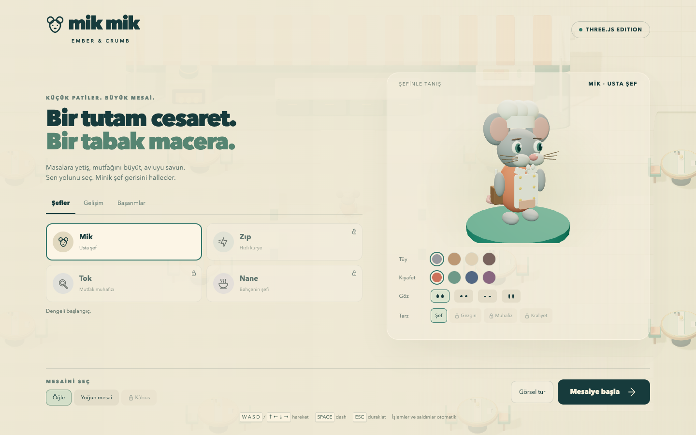
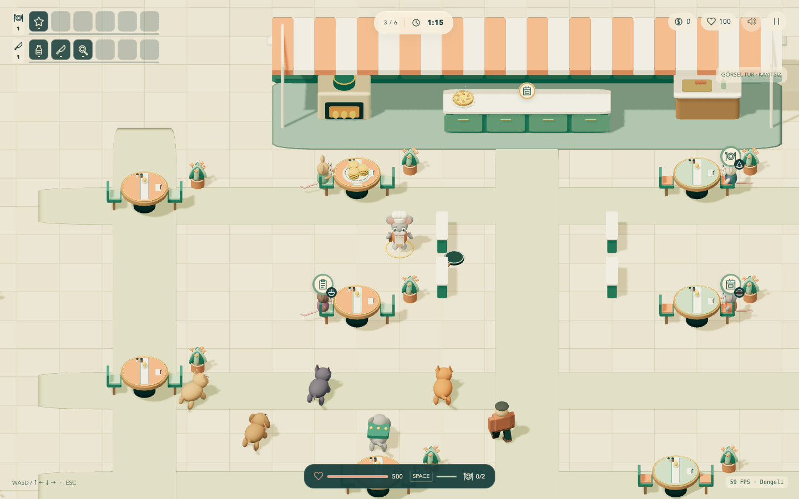

# Mik Mik — Ember & Crumb · Three.js

Fare şefli restoran / hayatta kalma roguelike oyununun bağımsız Three.js sürümü. Godot sürümüyle görüntü ve oynanış karşılaştırması için ayrı klasör ve private repo olarak hazırlanmıştır.





## Başlat

macOS'ta **Oyna.command** dosyasına çift tıkla. Node.js 22.12+ gerekir (bu bilgisayarda kurulu). İlk açılışta bağımlılıklar yüklenir; sonraki açılışlar çevrimdışı çalışır. Mevcut sunucu varsa aynı oyunu açar.

```sh
npm ci
npm run dev
```

Adres: **http://127.0.0.1:5178/**. Başlatıcı geliştirme sunucusunu yalnızca yerel bilgisayarda açar. Üretim derlemesi: `npm run build`, ardından `npm run preview` (önce geliştirme sunucusunu durdur).

## Oyna

- **WASD / ok tuşları:** hareket. **Space:** dash. **Escape:** duraklat/devam et.
- Sipariş sembollü masaya yaklaş; sipariş otomatik alınır ve mutfakta pişer.
- Hazır tabak için tezgâha git, müşterinin masasına dön. Servis ve temizlik yakınlıkla otomatik yapılır.
- Silahlar otomatik ateşler. Seviye seçiminde oyun durur; üç seçenekten birini tıkla.
- Müşteri halkası sabrı, küçük rozet yemek türünü gösterir. Ekran dışındaki müşteriler kenarda fare portresi ve yön oku olur.
- Menüde **Görsel tur**, yemek yiyen müşteriler ve farklı düşmanlarla hazırlanmış, kayıtsız oynanabilir bir sahne açar. Başarımları veya gerçek ilerlemeyi değiştirmez.

## Taşınan mekanikler

| Sistem | Bu sürüm |
|---|---|
| Harita / kamera | 64 × 52 m avlu, 10 masa; 23,5 birim ortografik kamera ve yürüdükçe takip |
| Yemek | Burger, pizza, çorba, peynir tabağı; otomatik sipariş, pişirme, taşıma, servis, yemek yeme, ödeme ve temizlik |
| Savaş | Çevreden gelen kedi, köpek, kara kedi, buldog, tilki, sopalı insan; altıncı dalgada patron |
| İnsanlar | 3. dalgadan itibaren yaklaşık %10–11; normal sodaya 5, başlangıç bıçak/tavaya 3 vuruş; tek hasar en çok canının %34'ü |
| İlerleme | Ayrı mutfak / savaş XP'si, 6 + 6 yuva, IV'e kadar geliştirme, boş yuvalar varken yeni eşya seçimi |
| Evrimler | Temizlik IV → 7 sn'de otomatik temizlik; kapasite IV → uzaktan tabak alma. Önkoşuldan sonra bir defalık teklif; mevcut yuvayı değiştirir |
| Ortam / müşteriler | Açık bulvar, hız şeridi, tüneller, çiçekler; gurme, öğrenci, müdavim |
| Karakter | Mik, Zıp, Tok, Nane; farklı silüet ve aksesuar, başarımla açılım; dört tüy, dört kıyafet rengi, dört göz şekli |
| Kalıcı ilerleme | Altı başarım, beş eğitim, üç zorluk; kalıcı bahşiş ve tarayıcı kaydı |
| Animasyon | Yürüme, dash, sipariş defteri, servis uçuşu, tabakta azalan yemek, kaşık/çiğneme, sıkılma/esneme, ödeme/toplama, silah, vuruş, ölüm, güç kazanma |
| Duraklatma | Escape, pencere odağı kaybı ve sekme gizlenmesi simülasyonu durdurur |

Bu karşılaştırma **mevcut tek oyunculu otomatik roguelike sürümünü** temel alır. Eski Ember & Crumb prototipinin ENet kooperatifi, manuel tarif zinciri, ruh/diriltme ve lobi sistemi bu sürümde yoktur.

## Görsel karşılaştırma

Godot projesi: `../Mik Mik Resturant`. Bu proje: `../Mik Mik ThreeJS`. Godot dosyaları ve kayıtları değiştirilmez. Three.js ilerlemesi `mik-mik-threejs-profile-v1` anahtarıyla bu tarayıcı/originde saklanır; Godot kaydından aktarılmaz. Tarayıcı verileri silinirse bu kayıt da silinir.

Kamera ölçüsü, harita ve temel denge yakındır; modeller bu sürümde Three.js geometrileriyle yeniden üretilmiştir. Bu, aynı varlıkların iki motorda piksel piksel render karşılaştırması değildir. Ekrandaki FPS aynı çözünürlük, aynı kalite, aynı kalabalık ve aynı donanım altında anlamlıdır; tek ölçüm bir motorun genel olarak daha iyi olduğunu göstermez.

Görüntü: yumuşak gölgeler, sRGB renk yönetimi, ACES ton eşleme, detaylı orijinal prosedürel modeller. Dengeli mod 1,5×, Yüksek mod 2× piksel oranı tavanı kullanır; Escape menüsünden değişir. Müzik yerine isteğe bağlı hafif sentezlenmiş efekt sesleri bulunur. Harici görsel/font/ses indirilmez.

## Doğrulama

```sh
npm test
npm run build
```

Saf simülasyon testleri: tam servis/ödeme döngüsü, sabır, pause, insan dayanıklılığı/dağılımı, yuvalar, evrim, XP, navigasyon, dash, kayıt/açılım, dalga/patron, kalabalık. Tarayıcı kontrolü geliştirme modundaki `/?test=1` ile bellek içi profil kullanır. Üretim derlemesinde test API'si yoktur.

```sh
agent-browser --session mik-three open 'http://127.0.0.1:5178/?test=1'
agent-browser --session mik-three eval --stdin < tests/browser-check.browser.js
```

## Kod

- `game.js`: render'dan bağımsız, sabit adımlı oyun simülasyonu.
- `navigation.js`: engeller, kayarak çarpışma, önbellekli yol bulma.
- `art.js` / `view.js`: paylaşılan geometri, statik mesh birleştirme, sahne ve animasyonlar.
- `profile.js`: tarayıcı kaydı, eğitim, başarımlar.
- `ui.js`: Türkçe menü, eşya yuvaları, kenar göstergeleri.

Repo **private** kalır. İlk aktarım `main`; sonraki tüm güncellemeler yeni bir `codex/...` dalında test edilip commit/push yapılır. Açık kaynak üçüncü taraf bağımlılıkları kendi lisanslarıyla kullanılır; oyun içeriği bu private projenin özgün içeriğidir.
